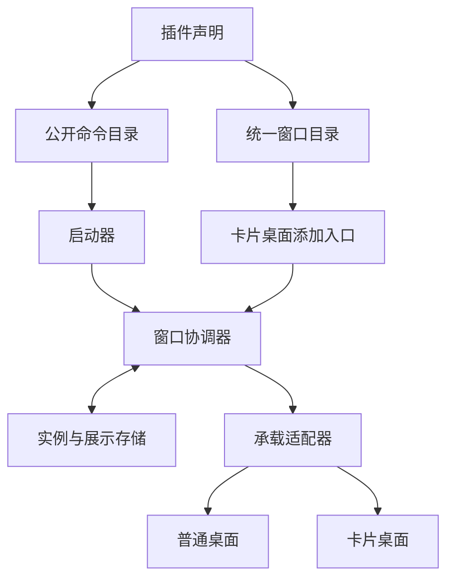

# 启动器与插件窗口框架技术方案

日期：2026-11-10。

状态：正在分支 `codex/plugin-window-framework` 实施。依据[产品方案](plugin-display-and-card-desktop.md)，核查基线为 `main` 提交 `c2f5b72`。本文描述目标技术合同；当前完成项、差距与验证证据见[进度记录](plugin-window-framework-progress.md)，不构成全部实现或实机验收完成的声明。

## 1. 总体选择

宿主建立统一的插件窗口目录：启动器读取公开命令；卡片桌面读取窗口声明中明确允许添加的业务窗口。便签、网速悬浮窗、普通插件页面共用窗口身份、展示和生命周期合同，底层承载可以不同。

1. 扩展现有 `ui.windows`，统一表达内容承载、可添加性、创建／恢复、复用、标题栏和窗口能力。原 `ui.widgets` 作为旧格式兼容输入，不再作为独立产品目录。
2. 分离插件运行实例、窗口实例和环境展示记录。多个窗口共享一个插件后台；置顶是普通桌面展示属性，不再是独立互斥模式。
3. 增加窗口协调器，所有打开入口经过共同路由；来源环境由主进程判定，不信任插件随意填写的环境参数。
4. 卡片桌面拥有独立添加清单，不再依赖普通桌面已有可见卡片。
5. 复用可信窗口、隔离 Web 壳、声明式 HUD、uTools runner 与桌面层的承载及呈现确认机制。跨环境不重建插件页面，不把第三方页面并入可信 React 执行域。
6. 不引入新 npm 依赖，复用 Zod、原子写入、资源作用域、命令桥、现有 UI 原语及 Windows helper 构建方式。

## 2. 现状与改动原因

下表 `plugins/`、`host/`、`ipc/` 均相对 `apps/desktop/electron/`，`shared/` 相对 `apps/desktop/`。

| 现有位置                                             | 当前行为                                                                      | 需要修改                                                       |
| ---------------------------------------------------- | ----------------------------------------------------------------------------- | -------------------------------------------------------------- |
| `packages/sdk/src/manifest.ts`                       | windows 要求 HTML entry；reuse 仅 singleton/document；titleBar 已弃用并被忽略 | 扩展新窗口合同、显式卡片桌面支持与标题栏声明                   |
| 同上                                                 | 普通窗口尺寸下限 160×60；widgets 使用另一套规则                               | 110 DIP 宽网速 HUD 需要统一目录，但不能被普通窗口硬下限挡住    |
| `plugins/runtime-composer.ts`                        | 按 profile/documentKey 缓存 Web controller，按命令选择窗口                    | 按真实实例缓存，接入目标环境路由，命令执行与窗口构造分开       |
| `host/desktop-windows.ts`                            | 官方窗口走专用工厂，document 复用与 Web 实现不同                              | 接入共同实例索引，保留官方 preload 和保存流程                  |
| `host/plugin-window-state.ts`                        | 按 pluginId＋profile 保存一份几何                                             | 多个同类窗口会串状态，改为实例／展示级保存                     |
| `shared/window-mode.ts`、`plugins/window-desktop.ts` | normal/topmost/desktop 互斥；desktop 关闭表示移出桌面                         | 改为环境＋普通桌面置顶；展示关闭与实例释放分开                 |
| `desktop-layer.ts`、`desktop-overlay-layout.ts`      | 从现有可见卡片投影；固定分类；按屏保存位置                                    | 独立清单、动态插件分组、跨屏一套坐标                           |
| `runtime.ts` overlay 配置                            | 添加项来自 command.window，先关闭 overlay 再 activate                         | 添加项来自窗口目录，创建后留在卡片桌面                         |
| `plugins/widget-host.ts`                             | 独立模板／实例目录，创建要求空位，过滤停用故障插件                            | 保留模板订阅和渲染，身份交给协调器；允许重叠，已有记录生成占位 |
| `plugins/utools-manifest.ts`、`utools-desktop.ts`    | 主要生成 feature 命令，runner 按插件单实例                                    | 兼容层生成等效窗口定义，保留 feature 激活状态                  |
| `ipc/note-commands.ts`                               | 编辑窗口存在时，删除便签报 noteInUse                                          | 调整为保存／关闭协调后删除，成功后清理全部对应展示             |
| `windows-runtime.ts`、`assets/FullscreenWatcher.cs`  | 观察前台全屏，不识别桌面顶部点击                                              | 增加窄范围桌面触发能力，不能混用两种检测结论                   |

## 3. SDK 与插件包合同

### 3.1 扩展 `ui.windows`

建议 Host API 从当前 `1.7.0` 升次版本至 `1.8.0`，发布前按当时版本确认。SDK 包版本与 Host API 版本分别维护。采用新字段的插件声明新 API 下界及相应最低宿主版本，旧宿主不能在忽略新能力的情况下安装新包。

| 字段／概念                                | 建议合同                                                                      | 默认及兼容                                                                    |
| ----------------------------------------- | ----------------------------------------------------------------------------- | ----------------------------------------------------------------------------- |
| 窗口 ID                                   | 继续用 ui.windows 稳定键，与 command.window 对应                              | 升级不无故重命名业务窗口                                                      |
| title/icon/translations                   | 继续沿用                                                                      | 复用 pluginPresentation 的本地化和已校验图标处理                              |
| content                                   | 页面入口或声明式内容；后者复用原 widget 模板、data、actions、hover 与订阅合同 | 旧 entry 归一化为页面；HUD 不必为统一目录改写为 HTML                          |
| cardDesktop                               | 明确允许添加到卡片桌面                                                        | 缺失默认 false；旧窗口不因有 HTML 就自动放行                                  |
| purpose                                   | business 或 dialog                                                            | 旧窗口归一化为 business；dialog 不得公开可添加                                |
| chrome                                    | host 或 none                                                                  | 默认 host，开发者按窗口声明，用户不可覆盖                                     |
| size/minSize/maxSize                      | DIP 尺寸；默认必须落在边界内                                                  | 统一后保留小型声明式窗口 80×32 级别的既有能力，不能强制 160×60                |
| resizable/minimizable/maximizable/taskbar | 分别声明操作能力                                                              | 缺失值按旧窗口实际行为归一化，卡片桌面再限制有效能力                          |
| reuse                                     | singleton/document/multiple                                                   | 旧 singleton/document 语义保留；document 缺内容标识时不能悄悄随机生成恢复身份 |
| create                                    | 仅首次新增使用的插件创建入口，可选                                            | 无业务创建需求可直接构造；新建业务内容必须返回稳定绑定                        |
| restore                                   | 已有内容打开／校验入口、参数版本、普通桌面自动恢复默认策略                    | 与 create 分开；恢复失败不能执行 create                                       |

复用现有 schema 的页面与声明式分支，归一化为宿主内部 `ResolvedWindowDefinition`。页面路径继续经过 confined/realpath 校验；official/utools 承载由宿主注册，第三方包不能指定可信适配器或任意本机程序。

归一化必须保留内容的原权限边界：旧 Web widget 继续使用受限 widget bridge 和隔离承载，不能因为进入统一窗口目录就升级为拥有完整插件能力的页面。旧 widgets 仅在兼容适配器已验证相应承载后生成明确的等效支持声明；既有展示可迁移，普通旧 windows 的 cardDesktop 缺失仍为 false。同 ID 的新旧定义不得同时注册。

原 `titleBar: native/custom` 在 API 1.7 已无效果，不能重新把旧 custom 解释成隐藏。新 chrome 单独定义；新包同时填写冲突的旧／新字段应拒绝。旧包维持兼容显示，官方包升级时显式声明。

原 presentation: standard/compact 只保留旧外观提示，不决定目录、恢复或窗口能力。desktopMinSize 仅用于旧格式迁移，新声明使用统一 minSize。

### 3.2 创建结果与恢复绑定

建议新增 `WindowBinding` 类型：包含 windowId、可选 contentId 和有版本的受限 JSON 恢复参数。宿主保存绑定，不理解插件业务结构；临时资源句柄、缓存绝对路径和过期文件授权不能成为永久内容身份。

首次新增可引用插件声明的隐藏创建命令，由后台返回绑定，不因此进入启动器。纯页面插件由页面适配器完成创建握手；无业务创建逻辑时宿主直接生成窗口实例。创建命令结果与普通业务返回值要分型，不能猜测任意 JSON 是窗口绑定。

创建使用稳定 creationId：

1. 先持久化创建意图，再调用插件；同一意图重试仍用相同 ID。
2. 便签增加按 creationId 幂等创建的业务操作，结果丢失后重复确认返回同一个 noteId。
3. 得到绑定后，先原子保存实例和展示记录，再加载内容。加载失败保留错误记录，重试打开已有绑定。
4. 结果未知时不换 ID 自动重发。支持幂等确认的插件查询／重试原意图，不支持的插件保留错误与原数据，不承诺恰好执行一次。

现有 `NoteStore.save(value, id)` 会拒绝不存在的显式 ID，需要增加独立幂等创建接口，不能直接把 creationId 塞给 save。实现沿用 NoteStore 正文／索引原子提交和回滚。创建与记录提交之间中断后，恢复意图只确认原结果，不再新建。

便签的 creationId→noteId 映射必须与创建索引同步持久化，不能只放内存或在返回成功后另写回执；否则崩溃重试仍可能重复新建。数据结构扩展沿用既有索引版本迁移，不为这一条记录引入新的数据库。

### 3.3 统一窗口 API

扩展 `packages/sdk/src/browser.ts`、`index.ts`，贯穿 preload 和主进程分发。以下是建议职责，不是已实现 API：

| API                                 | 职责                                                                                                |
| ----------------------------------- | --------------------------------------------------------------------------------------------------- |
| windows.open(windowId, request)     | 打开本插件已声明窗口，区分 open-existing/create/restore，携带业务绑定；默认环境由宿主来源上下文决定 |
| window.getState()                   | 当前实例、环境、chrome 和有效能力，供自绘 UI 调整按钮                                               |
| window.showMenu(anchor)             | 插件主动展示宿主标准窗口菜单，菜单项由宿主生成                                                      |
| window.setAlwaysOnTop(value)        | 仅修改当前普通桌面 placement，卡片桌面拒绝                                                          |
| window.addToCardDesktop()           | 给声明支持的当前窗口建立展示记录，否则拒绝                                                          |
| 现有 close/minimize/maximize/status | 统一校验环境与能力，不能直接操作 BrowserWindow 绕过协调                                             |
| 环境／能力变更事件                  | 同一页面接入和归还时更新 UI，不需要 reload                                                          |

插件不能传 HWND、任意 URL、其他插件实例 ID或可信环境标签控制别的窗口。普通插件只打开本插件声明窗口，跨插件执行继续走既有公开命令与权限规则。宿主面板列表使用独立管理接口，不向插件页面暴露全局管理权。

`windows.open` 的页面调用归属由当前 sender 绑定；后台调用由活跃 PluginOwner 与当次宿主调用令牌绑定。扩展现有 backend host-call 协议时只增加有类型的窗口请求及返回值，不能复用任意路径或无范围 RPC。主进程对请求再次验证窗口声明、输入绑定与启用状态。

旧 SDK 插件继续收到旧 `PluginActivation` 形状。主进程以调用旁路元数据保存可信环境，不给严格参数解析的旧插件额外塞字段；新页面上下文通过 API 版本判断扩展。

## 4. 窗口协调器与身份

### 4.1 模块分工

建议在 `apps/desktop/electron/host/` 新增以下领域模块，实施中可调整命名，但职责不混入业务：

| 模块                         | 职责                                                       | 复用／替代                                                |
| ---------------------------- | ---------------------------------------------------------- | --------------------------------------------------------- |
| plugin-window-catalog.ts     | 归一化安装清单和兼容声明，生成窗口目录并处理能力缓存失效   | 复用 plugins/manifest.ts、presentation.ts，不另造包解析器 |
| plugin-window-coordinator.ts | 打开来源、复用、创建、恢复、接入、归还、关闭与持久记录提交 | 接管 runtime、官方窗口和 Web controller 的分散决策        |
| plugin-window-adapters.ts    | 小型承载接口及现有官方／Web／声明式／uTools 适配组合       | 工厂仍负责自身页面和桥接，不给每个插件另建管理器          |

### 4.2 身份模型

| 身份                               | 作用                                                               |
| ---------------------------------- | ------------------------------------------------------------------ |
| pluginId＋windowId                 | 稳定窗口定义，跨插件版本保留                                       |
| windowInstanceId                   | 持久 UUID，表示具体内容或独立操作状态，不使用 Electron 临时窗口 ID |
| placementId                        | 一个环境的展示记录；同一实例可有普通桌面、卡片桌面两处记录         |
| contentId                          | 插件业务身份，如 noteId，用于 document 唯一复用                    |
| PluginOwner                        | 当前运行代次，继续用版本和 instanceId 校验，不作为持久窗口身份     |
| presentationRevision／overlayEpoch | 呈现与会话代次，拒绝过期异步响应                                   |

singleton 按 pluginId＋windowId 索引，document 加 contentId，multiple 按实例 UUID。便签唯一编辑器另以插件＋contentId＋编辑角色索引，避免 tile/notepad 各创建一个编辑器。

多个只读展示可指向同一 noteId；进入编辑时路由到唯一编辑器。保留便签已有编辑工具栏及模式切换，不用复制第二个可编辑页面实现多处展示。

### 4.3 打开来源与复用

主进程生成 launcher、card-add、plugin-window、restore 等来源，关联可信来源实例：

- launcher.ts／host/launcher-runtime.ts 执行公开命令时，窗口默认普通桌面；无窗口动作不收起卡片桌面。
- 页面内部打开时从 sender 绑定推导当前环境，不信任 payload 中的 environment；目标声明支持才跟随卡片桌面。
- 卡片「＋」调用协调器 create，不再 activate 后猜测应该显示在哪里。
- restore 单独路由，不运行新建命令，不恢复已经失效的临时授权。
- 未声明支持的业务目标返回 cardDesktopUnsupported，不强行嵌入和建立记录；插件可提供原有普通桌面入口。
- dialog 依附当前宿主窗口，不进入长期清单；原生对话框继续使用既有 parent 和模态管理。

同插件的打开按身份串行，pending-open 去重。先复用目标环境，multiple 无匹配则新建，singleton/document 才跨环境查找。复用 `presentation-epoch.ts`，保存等待期间重新打开应胜过过期关闭。

异步命令之后再打开窗口时，来源上下文随本次宿主调用令牌传递，不能用可被并发覆盖的全局“当前环境”。完成、取消、owner 替换后撤销令牌，后台事件不能借旧令牌抢焦点。

### 4.4 插件后台与页面分别启动

PluginManager 增加／归一化 ensureWindowOwner：校验启用状态与声明后取得共享 runtime 和当前 owner，不因“启动插件”就打开默认页面。现有 ensureWidgetOwner 中只接受 ui.widgets 的判定改为统一归一化目录检查，startupCheckOnly 仍禁止创建业务内容及恢复界面。

runtime-composer 保持一份 backend/native/broker，窗口 controller 按窗口实例惰性创建。卡片桌面恢复时只创建已添加的窗口，未声明恢复的普通窗口不受 on-startup 激活连带弹出；没有窗口的后台／动作插件继续沿原路径运行。

多个页面共享同一插件时，公开命令的处理不能广播到所有页面各执行一次。命令路由先确定目标窗口 controller，再投递一次激活；无窗命令优先已有后台。必须依赖页面的旧插件查询走原兼容 controller，不把查询注册次数和可见窗口数量绑定。关闭一个 controller 只释放本页面资源，不能停止共用后台、清空其他页面的订阅或授予新的共享能力。

## 5. 持久化与操作一致性

### 5.1 版本化状态存储

重构现有 `host/plugin-window-state.ts`，建议目标文件为 `configDir/host/plugin-window-layout.json`。实例、placements、创建意图及必要清理标记在同一版本化文件内原子提交。

| 记录               | 内容                                                                                                         |
| ------------------ | ------------------------------------------------------------------------------------------------------------ |
| instances          | 持久实例 ID、pluginId、windowId、contentId、版本化恢复参数和恢复策略                                         |
| placements         | placementId、instanceId、environment、bounds、visible、order；仅普通桌面保存 topmost／显示器信息             |
| cardDesktop        | 插件分组显隐等偏好；成员及单套相对工作区原点的 DIP 几何只以 card-desktop placements 为准，不存第二份添加清单 |
| pendingCreates     | creationId、目标窗口及环境、创建阶段、已取得的绑定，完成后清理                                               |
| cleanup／migration | 可重放清理记录、迁移版本和来源摘要                                                                           |

不持久化 HWND、WebContents ID、当前 owner 或当次借用快照。普通 placement 保存长期几何，借用前可见状态留在运行 session；重启按长期恢复策略重建。

复用 atomicWrite/readJson、Zod 及 unreadable-file 保护，文件无法读取时保留原文件并停止写入，不能用空状态覆盖。沿用有界 JSON／记录限制，超限明确报错而非静默丢弃，不把旧 widget 每插件 8 个配额当成新产品单实例限制。

### 5.2 关闭、删除与卸载

- 关闭一处展示：立即提交移除 placement，撤销尚在排队或等待恢复的旧展示意图，再按剩余展示隐藏、归还或释放页面。最后一个展示关闭才取消页面临时任务；保存失败不否决用户关闭。管理操作另行准备保存，遵循[Q6](launcher-availability-and-plugin-integration.md)。
- 收起整体：不发插件 stop、不删 placement、不销毁页面；卡片桌面专属窗口隐藏，借用窗口恢复快照。
- 关闭借来的面板：取消卡片 placement，普通 placement 有效时不销毁共用页面。
- 停止／停用：沿用 ResourceScope 与 ShutdownCoordinator 的 prepare/cancel/commit；成功后显示停用占位；保存失败或超时不自动结束业务进程。
- 删除内容：先完成对应编辑器的保存／关闭协调，再由插件提交删除；成功后清理该 contentId 的全部展示。现有 noteInUse 分支需要替换，不能直接删掉保护而跳过保存。
- 卸载：增加具有成功提交语义的管理器事件／回调，卸载成功后清理插件窗口记录。列表暂时缺席、初始化中或更新期间不等于卸载。

业务数据与宿主布局分属不同文件。成功删除后布局提交失败，应保留可重放的清理标记，重启后继续清理，不复活内容；取消／失败不提前删展示。新版暂缺窗口声明时保留不可用记录，不误当卸载，不自动新建替代内容。

跨文件清理的顺序需要明确：宿主在业务删除或卸载前记录待确认意图，但不移除 placements；业务成功提交后才将意图推进到可清理阶段。中断恢复时查询插件的内容是否已删除，或管理器的卸载提交结果；确认成功才继续清理，未知状态保留记录并报错，不能重发删除或用“当前列表没有插件”代替提交证据。复用既有卸载／维护串行队列，避免为此另建通用事务框架。

## 6. 呈现与承载接入

### 6.1 环境状态替代互斥模式

`shared/window-mode.ts` 改为环境 desktop/card-desktop、普通桌面 topmost、chrome 和有效 capabilities。旧 normal/topmost/desktop 仅为旧配置／桥接的转换入口，不再是产品状态源。

WindowModeController 改为呈现控制器，业务决策由协调器负责。接入卡片桌面前记录普通窗口 bounds、最小化／最大化、topmost、可见、taskbar、focusable、resizable；应用卡片布局并禁止最小化／最大化。收起恢复原属性，无普通 placement 的只隐藏。

点击抬前由统一 order 管理，不保存卡片置顶。底层为整体会话维持系统 Z 序而临时使用层级属性，不等于用户置顶；归还不能留下全局置顶窗口。

### 6.2 复用现有承载

| 承载           | 修改                                                                                           | 保留                                                              |
| -------------- | ---------------------------------------------------------------------------------------------- | ----------------------------------------------------------------- |
| 官方可信工作区 | host/desktop-windows.ts 接协调器，按实例 ID管理状态，增加环境与能力上下文                      | 官方 preload、工作区事件及保存确认                                |
| 隔离 Web 页面  | runtime-composer.ts 按真实实例缓存 controller；web-host.ts 接统一 API与 chrome；隐藏时内容占满 | 现有 BrowserWindow＋WebContentsView、隔离 session、导航和权限边界 |
| 声明式 HUD     | widget-host.ts 成为窗口承载适配，复用模板订阅；普通桌面为小型工具窗，卡片桌面参与统一呈现      | DeclarativeCard、流量数据／hover，不重复采集                      |
| uTools         | 等效窗口目录；runner 接收新呈现状态                                                            | 原 preload、feature 激活退出、存储与原窗口实例                    |

内容清单不再来自 overlayPanels 的 live visible cards。技术首版复用现有 shared surface 与 external participants，不一次性把所有原生壳及 WebContents 重挂入一个 renderer。

产品上是独立卡片桌面界面，底层不承诺只有一个 HWND。各承载必须共用焦点、Z 序、呈现确认和关闭会话。沿用 overlayEpoch、presentation ack、超时回退：未准备成功不能隐藏原普通窗口，失败后恢复此前展示。

收起或移动只改变呈现，不 close WebContentsView；最终释放时原 owner 显式关闭内容，避免只关壳泄漏页面。参考 Electron [资源管理说明](https://www.electronjs.org/docs/latest/api/base-window#resource-management)；本仓 Electron 45.1.0 的混合窗口焦点与层级仍需实际运行验证。

### 6.3 交互一致性

- 清理 desktop-layer.ts、utools-desktop.ts 等 blur 自动 closeOverlay 分支，普通失焦保持打开。
- 背景单击关闭，菜单、输入、拖动 pointer-up 不误判为背景；过期手势按 epoch 取消。
- 可信窗口、Web 壳、uTools 三处 Esc 统一：菜单／弹窗／IME 优先，卡片桌面未消费的 Esc 收起整体，不关当前面板。
- 标题栏双击、菜单和 SDK 都检查有效能力，不能只藏最大化按钮。
- HUD open-main 携带宿主环境上下文，卡片内打开流量详情；复用 widget-open-main.ts 的受限动作和用户交互校验。
- 保留页面、撤销栈、查询及后台任务，跨环境不 reload；跨进程呈现继续校验 owner／epoch。

### 6.4 宿主弹层与跨窗口优先级

2026-11-12 已确认采用「复用现有宿主窗口，临时抬高宿主弹层」方案，产品行为见[产品方案第 5.3 节](plugin-display-and-card-desktop.md#53-宿主弹层优先级)。本节尚未实施；用户实测的剪贴板历史遮住新增面板问题仍需修复。

当前新增面板的打开状态仅保存在 DesktopOverlayView 的 React 状态中，而 desktop-layer 的 restackOverlay 会将独立插件窗口抬到宿主窗口上方。DOM 内部的层级无法约束这些原生窗口，需要将弹层状态纳入同一主进程呈现协调。

- 复用现有 shared surface 和弹层原语，由 desktop-layer 持有当前会话内的宿主弹层状态，区分模态新增面板与普通菜单。不另建新增面板原生窗口，也不重挂插件页面。
- 弹层打开／关闭请求只允许当前宿主 surface 发起，并校验 sender、overlayEpoch 和本次弹层身份。先由主进程确认临时层级与输入策略生效，再将焦点交给弹层；旧会话的迟到关闭不能清除新弹层。
- 弹层存续期间，reconcile、restack、恢复完成、插件主动激活和 external participant 的抬前都遵守宿主弹层优先级。覆盖可信窗口、隔离 Web 壳、HUD 和 uTools，不只在打开时抬高一次，也不靠反复抢焦点维持顺序。
- 模态新增面板的遮罩覆盖本会话插件窗口，阻止指针穿透和键盘焦点进入卡片；现有窗口、WebContents、业务状态与订阅继续保留。普通菜单只遵循其自身的关闭和输入规则。
- 打开前记录会话内卡片相对顺序和焦点目标，关闭时恢复；目标失效则回到添加入口。新增成功则在新卡片完成呈现确认后关闭弹层并激活该卡片；失败保留弹层及可确认的创建绑定。
- 收起、销毁宿主或会话切换时清理临时状态；打开失败时撤销临时输入限制。不得将弹层优先级写入 placement.order、普通桌面 topmost 或恢复布局，不改变原窗口归还快照。

验收需同时覆盖：剪贴板历史重叠新增面板、多个独立插件窗口、菜单及更多插件、弹层期间插件恢复与激活、取消后焦点和顺序恢复、创建失败与重试、两级 `Esc`、输入法，以及收起后迟到消息。浏览器测试只能验证同一 renderer 内的行为，跨 HWND 层级、焦点和输入阻断必须另做 Windows 实机验收。

## 7. 卡片界面、标题栏与顶部触发

### 7.1 界面与管理 IPC

DesktopOverlayView.tsx 移除四个固定分类和 overlay-launch/favorite 对打开命令的依赖。读取窗口目录和 placements，按 pluginId 分组，单击显示抬前、菜单收起、溢出进更多插件。复用 command/dialog/dropdown 等现有原语，不自建第二套搜索组件。

DesktopWidgetManager.tsx 与 host/layer-instances.ts 改读统一窗口列表。停用／故障从持久记录生成占位，不因为没有 live surface 就消失。空界面只保留顶部添加，不加引导、推荐或别名。

归一化管理请求，并更新 shared/command-schemas.ts、desktop-contract.ts、command-policies.ts、layer-contract.ts 与 ipc/layer-commands.ts：

- 列出可添加窗口和 placements。
- 新建窗口、添加已有绑定、关闭 placement、重试 restore。
- 更新 bounds/order/visible，定位、分组显隐、整理布局。
- 打开／收起整体、在普通桌面独立打开目标。

请求绑定宿主 sender，卡片 surface 另检查 epoch。插件页面走自己的窗口 API，不能调用全局管理接口。旧 layer_* 迁移期转交新管理器，不同时写新旧状态。

### 7.2 标题栏与插件菜单

修改 StatusBar.tsx、WorkspaceTitleBar.tsx、useWindowMode.ts、PluginWindowContext.tsx、plugin-shell/main.tsx 和 uTools shell，统一读取主进程有效能力。

- chrome=host 绘制宿主标题栏，none 不占空间；Web 壳同步 WebContentsView bounds，不能留下 48px 空白。
- 便签 tile/notepad 的业务工具栏保留，宿主标题栏隐藏；管理窗口和流量详情显示。
- 菜单由插件触发，window.showMenu 由宿主生成操作项；anchor 解释为本窗口局部坐标并校验，不能接受系统任意坐标控制别的窗口。
- 无标题栏 Web 窗口使用现有 app-region，输入和按钮 no-drag；卡片伴随窗口沿用原窗口拖动并反馈几何，声明式 surface 复用手势逻辑。

Electron 拖动区域不产生普通指针事件，同一区域不能兼作拖动与业务按钮，参见[自定义窗口交互](https://www.electronjs.org/docs/latest/tutorial/custom-window-interactions)。

### 7.3 普通桌面顶部短横线

建议新增 electron/desktop-trigger.ts 和 assets/DesktopTrigger.cs，沿用 windows-runtime.ts 的源码 hash 缓存及系统 C# 编译方式。当前没有“只在 Explorer 桌面接收点击”的现成 Electron 能力，不能用常驻置顶透明窗覆盖应用顶部代替。

先做独立风险验证：在 Explorer 桌面宿主层放置不激活的窄触发窗，只占短横线区域，依靠系统层级使应用和任务栏优先；Explorer 重启、桌面宿主失效、锁屏时隐藏并重新绑定。不能因前台是桌面就推断所有屏幕顶部露出。

helper 只上报 hover/click/display，宿主校验开关与会话后展开。避免全局低级鼠标钩子、模拟输入和全屏透明输入罩，不改桌面系统设置。平台接入失败时禁用本次短横线并报告诊断，快捷键／托盘仍可用；不能宣称完成或偷换为抢输入的置顶热区。

新增配置开关（建议 desktopLayer.topTriggerEnabled，缺失默认 true），贯穿 config-schema.ts、host-config.ts、SettingsWindow、IPC 和双语本地化。copy-electron-assets.mjs 收集 helper 源码，退出注销入口／进程。顶部与自动隐藏任务栏不得被覆盖。

现有 FullscreenWatcher 只能复用编译及生命周期方式，无法证明上述桌面命中策略。该入口必须有 Windows 实机证据。

## 8. 官方插件与 uTools 改动

### 8.1 便签

修改 packages/official/notes/package.json，明确 main、notepad/tile 的窗口合同与 cardDesktop 支持，保留已发布 ID。单条便签隐藏宿主标题栏，绑定 noteId。

- backend.ts、official/notes-data-contract.ts、notes-data-client.ts、store.ts 增加幂等创建及恢复查询，创建结果持久化。
- host/note-surfaces.ts 的 openNote 和 host/official-runtimes.ts 改走协调器，按内容复用唯一编辑器；后台数据操作不打开页面。
- ipc/note-commands.ts、NotesDataClient 与后台成功删除路径增加可确认删除通知；成功后清理展示。
- NotePad.tsx、MainWindow.tsx、EditorPane.tsx 中添加已有内容携带 noteId；「＋」的新建路径创建新 ID。
- notes-layer.ts、capsules.ts 与 tile/notepad 切换保留为承载细节；索引统一编辑角色，折叠／贴边不退化。

本轮不捎带完成“全部便签业务从宿主移出”的历史计划。先统一路由及展示状态，复用现有数据层，避免两次大迁移耦合。

### 8.2 流量

packages/official/traffic/package.json 保留 main，新增 hud 窗口，content 采用原声明式模板，声明无标题栏、110 DIP 级尺寸、不可缩放等能力。迁移 ui.widgets.hud，不能重复注册成两个添加项。

backend.ts 保留单 sampler/service 及订阅，多处展示只增加订阅，不开启第二份采集。复用 widgets/hud.json 与 hover 模板；open 动作跟随环境，详情仍为 main。

关闭 HUD 取消本处展示、释放无引用订阅，不等于暂停采集或停止服务。普通桌面置顶与恢复意图从旧实例迁入，不用新默认值覆盖用户选择。

### 8.3 其他官方插件及发布

translation、clipboard、ocr、screenshot-history、quicklinks 等按真实业务窗口声明支持，不因“官方”而自动全放行。截图取框、系统文件对话框、Everything 等外部原生工作面不自动成为卡片业务窗口。

SDK／声明／打包内容变化时修改对应包版本及 API／最低宿主范围，按现有发布指纹验证。技术方案阶段不发布，不改已发布内容后继续复用旧版本号。

### 8.4 uTools

utools-manifest.ts 归一化时生成等效窗口描述，不改原 plugin.json。utools-runtime.ts、utools-runner.cts、utools-desktop.ts、utools-shell-preload.cts 接入环境合同。

- 同 runner 主界面映射一个 singleton，多个 feature 是激活状态，不转换为多个独立窗口／runner。
- 持久化有限 featureCode 和可恢复参数，不保留临时资源授权；没有 main 的列表壳依据实际能力适配。
- 沿用原初始化、feature 退出／进入、prepareStop，不伪造第二个 preload 生命周期。
- 支持条件、标题栏及尺寸由适配器声明，不要求旧包增加字段；未知外部子窗口不进入目录。
- owner/epoch 失效则取消呈现，旧 feature 迟到响应不能覆盖新状态，移除 blur 自动收起。

## 9. 旧状态迁移与备份

输入实际分布于 host/plugin-windows.json、host/desktop-layout.json、configDir/desktop-overlay-layout.json、便签及 uTools 布局。新状态放在 host/，由 PluginBackupService 的 hostRoot 统一覆盖；根目录 overlay 数据迁入后才能跟随此备份域。

读取并校验全部输入 → 生成稳定 ID映射及迁移计划 → 原子写新状态 → 完成标记 → 切换唯一写入方。原文件保留为迁移前来源，中断重跑使用同一映射，不重复创建实例。

| 旧记录                       | 新记录                                                                           |
| ---------------------------- | -------------------------------------------------------------------------------- |
| 普通插件窗口几何             | 普通 placement，保留 topmost，不自动新增卡片成员                                 |
| 旧 desktop/window            | 普通展示和恢复策略，不再沉到桌面底层作为独立模式                                 |
| HUD widget                   | traffic/hud 实例和普通 placement，已有 overlay 参与记录再建卡片 placement        |
| notes/capsule                | 保留 noteId 及展示形式，编辑器按内容唯一，不复制业务文件                         |
| uTools                       | pluginId＋兼容主实例，保留 featureCode，singleton 去重                           |
| overlay positions[displayId] | 优先当前／最近有效屏幕的布局，减工作区原点成为单套坐标，其他旧坐标保留在迁移来源 |
| favorites 命令入口           | 不转换为动作面板，不自动打开窗口，只迁移实际展示记录                             |

截图贴图等无可靠映射的 consumer 不能悄悄丢弃或伪造可加入声明。沿原 consumer 保留普通展示和数据，只有注册可信等效窗口后才进入卡片目录；迁移报告列明无法导入的记录与原因。

host/backup-runtime.ts 在备份／恢复前暂停新增、创建、清理和拖动提交，完成保存与 flush；恢复后重新加载目录、存储和绑定。信任、owner 和文件授权不能从备份直接复活。

旧宿主不能解释新存储，回退只能使用迁移前快照，不让旧版继续双写新状态。实施和发行说明明确该限制。

## 10. 文件改动清单

路径相对仓库根；省略前缀的 host/plugins/ipc/assets 位于 apps/desktop/electron，shared/src 位于 apps/desktop。新增文件名称可调整，但不能丢失职责边界。

| 层         | 修改／新增文件                                                                                                                                                                                                               | 主要输出                                              |
| ---------- | ---------------------------------------------------------------------------------------------------------------------------------------------------------------------------------------------------------------------------- | ----------------------------------------------------- |
| SDK        | packages/sdk/src/manifest.ts、browser.ts、index.ts、README.md                                                                                                                                                                | 窗口定义、绑定、API及兼容校验                         |
| 解析与目录 | apps/desktop/electron/plugins/manifest.ts、presentation.ts；新增 host/plugin-window-catalog.ts                                                                                                                               | 单一归一化目录，旧 widgets/uTools 适配                |
| 路由与实例 | 新增 host/plugin-window-coordinator.ts、plugin-window-adapters.ts；runtime.ts、launcher.ts、host/launcher-runtime.ts                                                                                                         | 来源、复用、创建恢复及关闭协调                        |
| 运行时     | plugins/runtime-composer.ts、manager.ts、desktop-host.ts、backend.ts、backend-worker.ts                                                                                                                                      | 共享后台、多实例 controller、可信上下文、卸载成功回调 |
| 存储       | host/plugin-window-state.ts、layer-layout-store.ts、desktop-overlay-layout.ts                                                                                                                                                | 版本化实例／展示、迁移与清理记录                      |
| 呈现       | plugins/window-desktop.ts、desktop-layer.ts、layer-window.ts、plugins/web-host.ts、host/desktop-windows.ts                                                                                                                   | 环境状态、接入归还、焦点与 Z 序                       |
| 桥接与 IPC | shared/plugin-windows.ts、window-mode.ts、layer-contract.ts、utools-desktop.ts、command-schemas.ts、command-policies.ts、desktop-contract.ts；ipc/layer-commands.ts、window-commands.ts；各 preload                          | 有效能力、管理请求与本窗口 API                        |
| 卡片 UI    | src/features/desktop-layer/DesktopOverlayView.tsx、DesktopLayerView.tsx、DesktopWidgetManager.tsx、DesktopPanelToolbar.tsx、相关 CSS                                                                                         | 添加目录、分组、占位及排列                            |
| 标题栏     | src/features/windows/StatusBar.tsx、WorkspaceTitleBar.tsx、useWindowMode.ts、PluginWindowContext.tsx；src/features/plugin-shell/main.tsx、src/features/utools-shell/main.tsx                                                 | chrome、能力按钮、Esc、自绘 API                       |
| 顶部入口   | 新增 electron/desktop-trigger.ts、assets/DesktopTrigger.cs；windows-runtime.ts、host/menus.ts、shortcuts.ts、shared/config-schema.ts、host-config.ts、SettingsWindow、locales、apps/desktop/scripts/copy-electron-assets.mjs | 短横线、开关、平台生命周期及打包                      |
| 官方适配   | host/official-runtimes.ts、host/note-surfaces.ts、ipc/note-commands.ts、plugins/official/notes-data-*、store.ts、packages/official/notes 和 traffic 及相关 renderer                                                          | 便签绑定、HUD 窗口、成功删除后清理                    |
| uTools     | plugins/utools-manifest.ts、utools-runtime.ts、utools-runner.cts、utools-desktop.ts、相关 preload                                                                                                                            | 等效声明及原实例呈现                                  |
| 备份和版本 | host/backup-runtime.ts、plugins/backup.ts、插件 package.json、scripts/build-official-plugins.mjs、现有发布校验                                                                                                               | 新状态备份、窗口资源收集、版本指纹                    |

## 11. 分期与验证

| 阶段          | 内容                                                           | 完成条件                                                             |
| ------------- | -------------------------------------------------------------- | -------------------------------------------------------------------- |
| T0 风险验证   | 既有窗口无重载接入／归还、混合 Z 序／IME／模态；桌面短横线命中 | 有实际运行证据，失败边界明确；未通过不标完成                         |
| T1 合同与目录 | SDK、归一化窗口目录、能力和兼容 API                            | 无窗口插件继续运行，新旧包正确验证，目录不混命令／弹窗               |
| T2 存储与协调 | 实例／placement、创建意图、复用、恢复、关闭及迁移              | 恢复不新建，关闭使迟到恢复失效，最后一个展示释放任务，单实例归属正确 |
| T3 卡片接入   | 独立清单、呈现、API／标题栏、分组布局                          | 添加留在卡片桌面，环境独立布局，禁止卡片置顶／最小化／最大化         |
| T4 插件适配   | 便签、流量、其他官方窗口、uTools、成功清理                     | 唯一编辑器、一份采集，uTools 不按 feature 复制 runner                |
| T5 交付验证   | 顶部入口、设置、迁移备份、构建和 Windows 验收                  | 三种唤起入口一致，系统输入不被遮挡，独立验证记录完整                 |

优先扩展已有 plugin-window-state.test.ts、plugin-window-activations.test.ts、desktop-overlay-layout.test.ts、layer-layout-store.test.ts、desktop-layer.test.ts、utools-compatibility.test.ts、desktop-host-restore.test.ts。新协调器只有现有用例无法覆盖独有逻辑时才另建测试文件。

有价值的行为验证：

- 并发打开 singleton/document 只创建一次；目标环境复用不改变另一个 multiple 实例的操作状态。
- 创建成功后响应丢失、布局提交中断、重启恢复不重复便签；损坏文件不覆盖。
- 保存拒绝、保存等待中重新打开、owner 被替换后不误隐藏或终止当前进程。
- 借用、仅卡片所有、关闭一处仍有其他展示三种归属各取代表。
- 未声明支持不能接入，跨实例伪造被拒绝，卡片最大化／置顶在 API层也拒绝。
- 停用保留、卸载成功与内容删除清理，取消失败不提前清理，旧 owner 不删除新实例。
- 真实 UI 验证添加新便签、关闭面板与收起整体，不能用源码字符串断言或文案快照代替。
- 宿主新增面板和菜单高于所有会话成员；弹层期间插件恢复、激活不越层，关闭或切换会话后输入、焦点和原顺序正确恢复，不改写持久布局。

UI 扩展 DesktopOverlayView.browser.test.tsx、DesktopLayerView.browser.test.tsx、PluginWindow.browser.test.tsx，复用现有 desktop transport fixture。新目录需核对 vitest.browser.config.ts 和 vitest.config.ts 的 discovery；当前浏览器配置仍点名部分旧 features 路径，涉及插件 renderer 时不能假定已自动纳入。

Windows 实机单列：短横线只响应露出的 Explorer 桌面；顶部／自动隐藏任务栏和最大化应用优先；普通失焦不收起；双屏一屏展开；拖动、IME、右键、模态、跨 HWND Z 序、保存失败继续运行。基本防越界只保证管理和拖动入口，不扩展复杂分辨率验收。

Windows 通过 Git Bash 和 scripts/use-toolchain.sh，Node/pnpm 依 .node-version 和 package.json。实施完成串行运行适用门禁：typecheck、lint、格式检查、Node 测试、UI 测试，再构建／打包。本地化覆盖双语并运行现有 checker。原生资源或词典缺失则明确报告，不以静态通过代替打包验收。

本文只运行文档格式、链接和范围检查；上述门禁均是后续实施计划，不能记为已通过。

## 12. 范围约束

- 合同先定、消费方分批迁移，任何阶段只有一个持久状态写入方。
- 展示变更不是插件重启，不复制业务数据库，不因面板关闭自动停止后台。
- 旧包和 uTools 通过可审计的兼容目录接入，不能从“有一个命令”推断可添加窗口。
- 第三方页面保持隔离，窗口 API 不扩展任意 Node、系统窗口和文件权限。
- 不重新引入撤销关闭、面板别名、空界面引导、卡片置顶／最大化、固定到桌面状态及卡片快捷动作区。
- 旧实机证据只证明旧行为；新窗口归属、卡片桌面、顶部入口和迁移重新验收。
