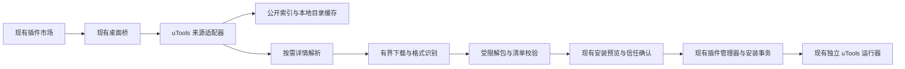

# 内置 uTools 插件市场设计

日期：2026-11-04。本文保留完整市场设计；当前已实现官方目录浏览与排序、本地 `.upx/.upxs` 导入、官方下载检查、确认安装、来源绑定及版本更新。使用现有发现／任务／已安装界面，支持同版本内容变化的人工确认。图文详情分栏与基于产物证据的兼容筛选仍是后续界面范围，不显示未经验证的「已验证」标记。

实现及验证见 [商店安装与更新](evidence/utools-store-install-update-2026-11-04.md)，已验证包格式与来源见 [包格式说明](utools-package-format.md)。

## 1. 目标与入口

让用户在 spark233 中完成 uTools 插件的查找、查看详情、下载检查、确认安装和后续更新。入口沿用「设置 → 插件市场」，与已有插件共用安装任务、已安装列表及插件配置。

页面顶部仍为「发现／已安装／任务」。「发现」增加来源切换「spark233／uTools」；「已安装」增加来源筛选，在同一个列表管理两类插件。「任务」继续展示全部来源的安装、更新和恢复任务。

默认来源保留 spark233，记住用户上次选择的来源。用户首次进入 uTools 分类时才加载其目录；启动器正常启动和输入搜索不主动请求整个商店。

本期目标是公开可获取且可解析的本地插件。账号、支付、云同步、官方商店登录和应用内购买沿用当前不支持范围。商店目录可检索不等于每个插件都能运行。

## 2. 已核实的接入条件

2026-11-04 获取官方网页及公开搜索索引，确认以下事实：

| 数据                                                                                      | 已观察到的内容                                                                                    | 用途及限制                                                               |
| ----------------------------------------------------------------------------------------- | ------------------------------------------------------------------------------------------------- | ------------------------------------------------------------------------ |
| [官方网页市场](https://www.u-tools.cn/plugins/)                                           | 插件列表、详情链接、调用 uTools 客户端的打开链接                                                  | 展示来源；客户端打开链接不作为 spark233 的安装接口                       |
| [公开搜索索引](https://www.u-tools.cn/plugins-search-index.json)                          | 本次为 4,462 条，约 1.48 MB；含 name、pluginName、description、logo、rating、voters、author、href | 支持搜索、作者和评分展示；没有现成的版本、分类、下载量和安装包哈希       |
| [Markdown 笔记详情](https://www.u-tools.cn/plugins/detail/Markdown%20%E7%AC%94%E8%AE%B0/) | HTML 中的 JSON-LD 含 softwareVersion、fileSize、downloadUrl；页面有 `.upxs` 离线下载              | 详情按需解析；仅确认这个样本，不能推断所有条目都有相同字段               |
| 离线包样本                                                                                | Range 请求可取得 `.upxs` 二进制内容                                                               | 只观察了包头，尚未验证格式、签名或解包；不把它视为普通 ZIP/TGZ           |
| 当前 spark233                                                                             | 预构建目录导入、独立兼容运行器、代码信任、安装事务、数据备份已有实现                              | `.upx/.upxs` 解包和商店更新来源仍需新增；现有更新来源主要为 npm registry |

公开网页和静态索引暂未发现版本化的稳定接口约定。因此将其放在单独的来源适配器中；字段改变时允许目录或详情降级，不让网页变化影响已安装插件。

## 3. 页面与交互

### 发现列表

延续当前插件市场的列表行、字号、主题和按钮样式。每行包含图标、名称、作者、一行简介、兼容状态和「查看详情」。已安装插件补充「已安装／有更新」，不混淆来源评分和兼容状态。

搜索使用现有顶部搜索框，匹配名称、作者和简介。初期提供「全部／已验证／未验证／暂不支持」筛选和名称、评分排序；不创造索引中没有的官方分类或下载排行。评分缺失时显示「暂无评分」，有评分时同时显示评价人数。

目录按页返回，建议每页 20 条。初期不为几千条目录引入新的虚拟列表依赖；前端只挂载当前页，图片按需加载。搜索、筛选、选中插件、页码及滚动位置在返回列表时保留。

### 插件详情

宽内容区采用列表与详情并列；内容区不足约 760 DIP 时，进入详情替换当前列表，并提供「返回列表」。不要求扩大现有设置窗口，不新增独立商店窗口。

详情依次展示：名称和作者、来源、版本和包大小、兼容说明、简介、截图、更新说明、官方页面入口和主要操作。字段不可获取就省略或说明未提供，不填造数据。截图延迟加载，外部富文本转为安全内容，不运行远程脚本。

主要操作随实际状态变化：

| 情况                                 | 主要操作   | 说明                             |
| ------------------------------------ | ---------- | -------------------------------- |
| 未安装、未取得和检查包               | 下载并检查 | 先准备安装包，不提前执行插件     |
| 已检查、允许安装                     | 确认安装   | 沿用现有安装预览与代码信任确认   |
| 已安装且没有已确认更新               | 打开／管理 | 接入现有激活和插件配置           |
| 已确认有新版本                       | 查看更新   | 展示变化后由用户准备更新         |
| 当前平台、包格式或必要能力明确不支持 | 暂不支持   | 展示具体原因和官方页面入口       |
| 数据或网络暂时不可用                 | 重试       | 保留列表、选中项和已经安装的数据 |

不在每次打开详情时弹警告。现有完整代码信任确认只在安装确认阶段出现；新增权限时按已有更新流程重新确认。

### 未安装插件的完整路径

1. 点击「查看详情」，取得当前版本及下载入口。
2. 点击「下载并检查」，任务进入现有「任务」页；详情同步显示下载字节和检查状态，支持取消。
3. 解包、校验入口与身份，判断当前平台和已知兼容要求。全过程不执行第三方 preload。
4. 展示安装预览：插件名称、实际包内版本、来源、兼容说明和已有代码信任确认。
5. 用户确认后，使用现有管理器提交安装并启用；完成后显示「打开／管理」。

包格式无法解析时停在第三步，明确显示「当前版本暂不支持此包格式」。任务保留失败原因，已有插件和数据不发生变化；不把仅下载成功记成安装成功。

### 任务和关闭行为

同一个插件已有准备任务时，重复点击打开该任务，不重复下载。离开市场页面后下载继续，由现有任务管理器持有；关闭应用遵循已有取消和退出流程。

下载长度未知时显示实际已接收字节，不用详情页的格式化大小伪造百分比。仅在可安全中止的阶段显示「取消」。更新进入保存、备份或切换后沿用既有阶段规则，避免中断原子提交。

## 4. 兼容状态与安装状态分离

「已验证／未验证／暂不支持」描述兼容证据；「未安装／下载中／待确认／已安装／有更新」描述任务或安装状态。两类状态分别保存和展示。

| 兼容状态 | 判定依据                                                 | 用户可做什么                                             |
| -------- | -------------------------------------------------------- | -------------------------------------------------------- |
| 已验证   | 有与此包内容哈希、宿主兼容范围和平台相匹配的代表验证记录 | 查看验证范围；首次安装仍需下载检查和代码信任             |
| 未验证   | 没有匹配的验证记录，或包、平台、宿主版本已超出验证范围   | 先下载检查；检查通过后允许按现有完整代码信任流程尝试安装 |
| 暂不支持 | 包格式不支持、平台不匹配，或已经确认的必要能力不可用     | 查看原因；可浏览来源页面，不能伪装成可安装               |

目录默认「未验证」。官方评分、作者名称、一次成功启动和静态字符串搜索均不产生「已验证」标记。不能仅因为包里出现某段 API 名称就断言整个插件不支持。

验证记录绑定实际产物，不把公开源码构建的测试结果直接套给同名商店包。新内容哈希重新显示「未验证」，除非存在对应记录。验证范围写明平台、宿主范围、场景和时间；不宣称验证覆盖了全部功能。

## 5. 安装、更新与数据保留

商店安装继续使用现有不可变代码版本、管理器、资源归属、运行器和插件数据目录。已有 uTools 目录导入不迁移插件身份，不复制或重建用户数据。

目录 `name` 作为商店条目标识，包内清单按现有规则确定插件身份，二者分别记录。名称相同不构成身份相同。首次绑定记录实际清单身份与来源；更新身份不一致时拒绝替换，提示按新插件处理。

已有本地导入与商店候选的插件身份一致时，展示已有版本及数据保留说明，经明确操作后绑定商店更新来源；不按展示名称自动接管本地插件。

需要扩展安装来源和更新来源的合同，使其表达 uTools 目录条目、实际下载 URL、上游版本、产物内容哈希与检查时间。同步更新持久化校验、安装预览、备份和恢复记录，并对旧记录保留读取兼容；不能只在前端补一个字段。

更新默认只提醒，点击后按原安装流程准备包、确认、保存、备份、切换和恢复。旧插件拒绝保存、保存失败、确认取消或超时，均不强制终止业务进程。

兼容包现有版本含内容指纹，不能把指纹的字典顺序作为版本先后：

- 上游有效语义版本变大：提示有更新。
- 上游版本相同但取得的包哈希变化：显示「同版本内容变化」，由用户决定是否替换，不后台静默切换。
- 版本缺失或不可比较：只提供人工刷新和重新检查，不推断升级或降级。
- 自动检查只处理已绑定的已安装插件，不扫描或下载整个目录；初期不新增周期后台服务。

## 6. 来源与缓存架构

新增工作限于来源适配器、受限包格式适配器、来源合同和页面投影，复用已有下载限制、安装事务、备份、任务和运行器；不搭建自有商店服务，也不另建一套插件管理器。

### 数据加载

- 索引采用本地文件缓存和内存规范化结果，建议有效期 6 小时；过期先显示缓存，再后台刷新，界面显示缓存时间。
- 无缓存且离线时显示错误与重试；不会影响 spark233 内置目录和已安装插件。
- 首次打开详情时才请求对应页面，提取版本、下载入口、简介与截图。公开页面结构变化时只禁用受影响的详情或安装，保留目录浏览。
- 主进程负责网络和解析，通过现有桥向渲染器提供有界、分页的规范化数据。渲染器不传任意下载地址，而是传目录条目 ID 或宿主签发的准备凭据。
- 列表切换、刷新和取消使用请求代次；迟到响应不得覆盖新搜索和新选择。目录刷新失败保留上次成功结果。
- 详情缺少稳定发布标识时，内容哈希只在实际下载后确定。目录页不能预先计算或许诺安装包哈希。

### 下载和解包边界

初期只接受已核实的官方 HTTPS 来源及必要的下载域名；重定向后重新检查目标。HTML 只提取允许字段，图标及截图通过已有受限资源能力展示，不加载官方商店脚本。

沿用现有归档、单文件、总展开体积、文件数量和路径深度限制，禁止目录穿越、符号链接和包外入口。未知包格式明确拒绝，不按扩展名猜测压缩格式，不在导入阶段执行安装脚本或 preload。

下载时计算内容哈希，用于产物绑定、重复识别和不可变版本；官方没有提供可验证签名时，不能把自算哈希宣传为「官方签名验证通过」。签名、编码或格式存在不能解析的条件时停止安装。

### 性能预期

约 1.48 MB 的索引按需获取，本地搜索无需逐字联网。列表分页、图标延迟加载、详情按需读取；关闭页面后释放页面订阅和非必要内存，下载仍由现有任务持有。浏览商店不启动任何兼容运行器，不为商店增加一个常驻 Electron 窗口或独立后台服务。具体内存和时延预算以实现后的测量为准。

## 7. 失败及恢复

| 情况                               | 页面行为                                 | 数据与进程行为                             |
| ---------------------------------- | ---------------------------------------- | ------------------------------------------ |
| 索引请求失败                       | 展示缓存及上次更新时间；无缓存则重试入口 | 已安装插件不受影响                         |
| 详情缺字段、页面改版、下载入口失效 | 目录可见，详情显示当前不可安装及原因     | 不创建假候选或空版本                       |
| 包格式、签名条件或解包不支持       | 显示明确原因及来源页面                   | 不执行插件，不覆盖旧版本                   |
| 下载取消、断网、大小超限           | 任务可重试，恢复用户之前的选择           | 仅清理本任务持有的临时文件                 |
| 权限或代码信任被拒绝               | 继续等待确认或取消准备                   | 插件不启动                                 |
| 保存确认失败或取消                 | 保留待处理更新及具体原因                 | 原业务进程继续运行                         |
| 新版本启动失败                     | 进入既有恢复流程，提示实际恢复结果       | 保留旧代码与备份，遵循现有数据迁移恢复规则 |
| 最新商店包无法运行                 | 展示失败说明及当前插件状态               | 不把一次失败自动写成所有版本均不兼容       |

## 8. 实施顺序与交付条件

### P0：先证明真实离线包能进入现有运行器

取得若干公开可下载样本，分别识别 `.upx` 和 `.upxs`；确认格式是否有签名或其他必需条件，优先复用现有依赖或维护中的成熟解析能力。验证无执行解包、清单身份、入口和真实运行；不能只改扩展名过滤或用自行压成的 TGZ 代替商店包。

交付条件：至少有实际商店下载产物完成「下载 → 解包 → 预览 → 安装 → 运行 → 重启保留数据」，并单独验证更新拒绝保存时旧实例仍运行。不支持的格式列明原因，界面据此控制安装入口。如果 P0 不通过，后续只能交付目录浏览与可用来源跳转，不把它称为一键安装商店。

### P1：同一市场中的完整发现与安装

增加来源切换、目录缓存、搜索分页、详情、兼容状态和下载检查；接通现有任务及确认安装。商店产物通过 P0 后开放相应格式的安装按钮，尚未支持的条目仍能浏览。

### P2：更新与已有插件绑定

补齐来源持久化、旧记录兼容、商店版本查询、来源绑定、同版本内容变化、恢复及卸载。统一在现有已安装列表提示更新，由用户手动执行。

P0、P1、P2 组成目标功能。分期用于降低格式风险，不默认把「更新」从最终范围中删去。

## 9. 验收要点

后续实现优先扩展已有导入、任务、管理器、来源和浏览器用例，不新增另一套测试框架。

- 浏览、搜索、详情和返回列表可操作；窄宽度、长名称、空结果、评分缺失和离线状态可读。
- 目录可检索与包可安装分别展示；同名源码样本的验证状态不误用到商店包。
- 真实 `.upx/.upxs` 样本按已经证实支持的格式验收；畸形路径、超限包、取消和过期回调拒绝。
- 下载和预览阶段不运行第三方代码；拒绝信任后不能激活；安装完成才进入运行状态。
- 稳定插件身份、已有本地数据、重复安装、商店来源绑定、同版本内容变化和备份恢复保持一致。
- 用户拒绝保存、保存失败和超时不会触发自动强杀；更新失败能说明实际恢复结果。
- 类型、格式、lint、相关自动检查和构建按仓库流程串行执行；真实包运行、安装包分派及物理窗口操作分别记录，不能互相代替。

## 10. 交互预览范围

预览演示来源切换、搜索筛选、列表详情、未验证／不支持、下载检查、安装确认和任务状态。版本、兼容结论与安装结果均为示例数据；交互仅在预览内生效，不进行真实下载、安装或业务数据写入。
